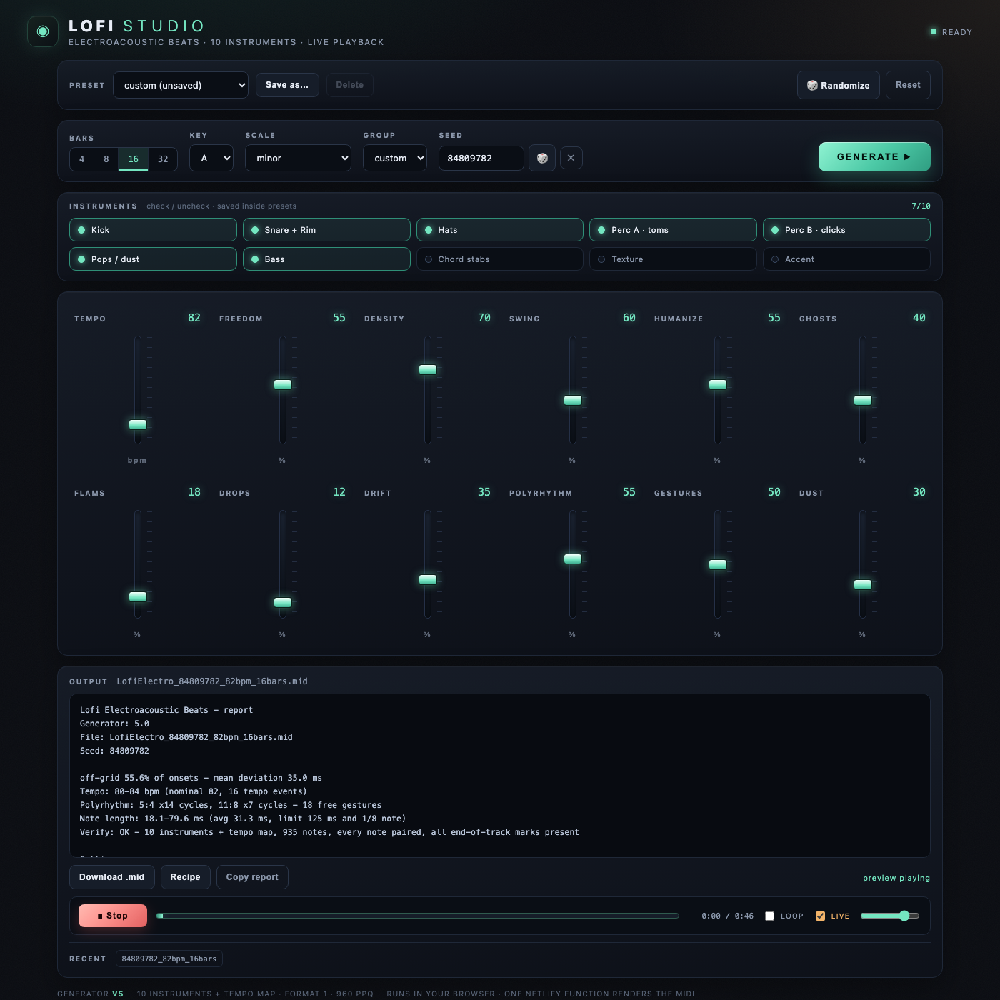

# Lofi Studio

A standalone web version of **Lofi Electroacoustic Beats**: twelve vertical faders, ten
per-instrument toggles, factory/user presets, real-time preview and MIDI download.

- **Static UI** in `public/` (HTML/CSS/vanilla JS, no build step).
- **One Netlify Function** (`netlify/functions/generate.js`) renders the `.mid` with the same
  generator as the local Studio (`gen-lib.js`, 10 instrument tracks + a tempo-map track).
- **Presets & last settings** live in `localStorage`; nothing is stored on a server.
- **Playback** uses Web Audio to synthesise the rendered file in the browser.



## Deploy on Netlify

1. Push this repo to GitHub (done: `elianstudios/lofi-studio`).
2. Netlify → **Add new site → Import an existing project → GitHub** → choose the repo.
3. Build command: **leave empty**. Publish directory: **`public`**. Functions: **`netlify/functions`**
   (these are already in `netlify.toml`).
4. Deploy. Netlify bundles the function automatically.

The function has no database, no keys and writes only to `/tmp`; the MIDI is returned as base64
and downloaded by the browser. Typical render time is well under a second.

On a first visit the page renders one beat automatically so **Play** is ready; after that the last
render is restored from `localStorage` (no extra function call on reload).

## Run locally

```bash
npm run dev          # node dev.js -> http://127.0.0.1:8790/
```

`dev.js` serves `public/` and mounts the real function at `/.netlify/functions/generate`, so the
local page behaves exactly like the deployed one.

## Controls

- **Faders:** TEMPO 5–500, FREEDOM, DENSITY, SWING, HUMANIZE, GHOSTS, FLAMS, DROPS, DRIFT,
  POLYRHYTHM, GESTURES, DUST.
- **INSTRUMENTS:** Kick, Snare + Rim, Hats, Perc A (toms), Perc B (clicks), Pops/dust, Bass,
  Chord stabs, Texture, Accent. GROUP is a shortcut (`drums` excludes the pitched Accent).
- **PRESET:** four factory sounds (`dusty`, `broken`, `cloud`, `overdrive`); *Save as…* stores
  faders + instrument selection + seed in `localStorage`.
- **SEED:** same seed + same settings = the same file; empty = a new variation per render.
- **LIVE:** while playing, moving a fader re-renders and continues from the same relative position.
- **Play** is always active: if nothing has been rendered yet it generates a beat and plays it;
  the last render is kept in `localStorage`, so a reload has Play ready.
- **Download .mid / Recipe / Copy report.**

## Files

| Path | Role |
|---|---|
| `public/index.html`, `style.css`, `app.js` | the interface |
| `public/player.js` | MIDI parser + Web Audio preview synth |
| `netlify/functions/generate.js` | Netlify Function: settings → `.mid` + report + recipe (base64) |
| `netlify/functions/gen-lib.js` | the generator (same code as the local Studio v2) |
| `dev.js` | local static + function dev server |
| `netlify.toml` | publish dir, functions dir, Node version |

## Notes

- The MIDI file has **11 MTrk chunks**: 10 instrument tracks + the tempo map. The UI labels it
  "10 instruments + tempo map".
- Presets are per-browser (`localStorage`). To share one, copy the JSON from
  `localStorage["lofiStudio.presets.v1"]`.
- No AI, no API keys, no external services.
